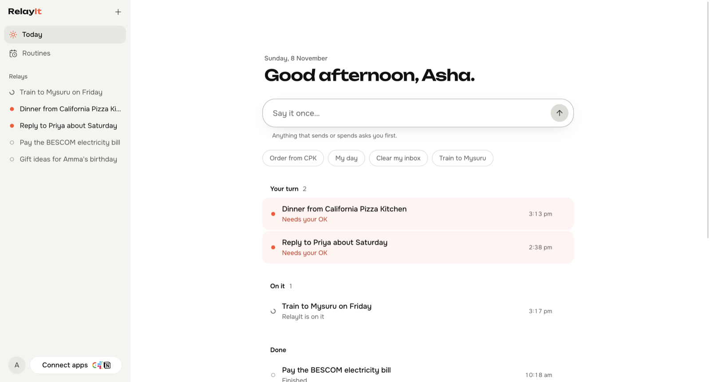
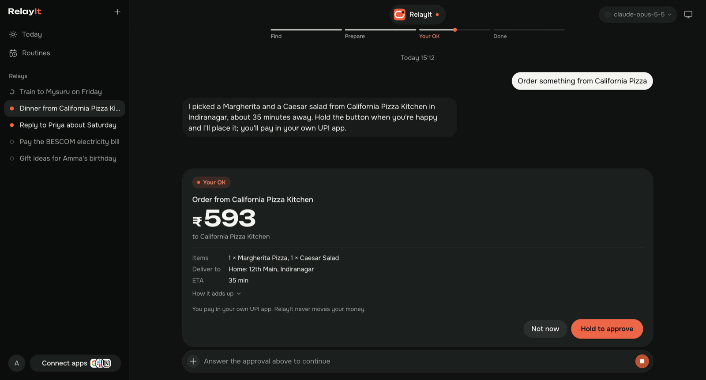

# RelayIt

**Say it once. RelayIt handles the rest.**

A personal AI agent for your computer, built for India. Tell it what you want in plain language: "Order something from California Pizza", "What needs me today?", "Block 30 minutes for the gym". It works out the steps, and asks before it spends money or sends anything.



## How it works

- **Say it once.** Type or speak what you want on Today, or press **⌥ Space** (Ctrl+Alt+Space on Windows) from anywhere. Each request is a *relay*: RelayIt finds, prepares, and comes back only for **your OK**.
- **Your OK means something.** Anything that sends, books or spends asks first. A purchase shows the amount in ₹, who it goes to and what is in it, and you hold the button to approve. Money never gets "always allow".
- **It never touches your money.** You pay in your own UPI app from a QR or link; RelayIt only prepares the order.
- **Part of your day.** A morning brief (what needs you, your calendar, bills coming due), a Sunday recap, and your usuals one tap away.
- **Bring your own model.** The Claude or Codex app you're signed in to, an API key, or a model on your own machine through Ollama.
- **Local first.** Your data stays on your computer, and credentials are encrypted at rest.
- **Knows India.** Swiggy, Zomato and Wispr Flow through their official connections; trains, Namma Metro and UPI handoffs; Gmail and Google Calendar directly. English and Hindi.
- **More when you want it.** Settings → Advanced turns on a team of assistants, each with its own model, memory and apps.



Food and travel use demo data until an official connection is signed in. RelayIt never handles your money: it shows a UPI QR or link, and you pay in your own app.

## Run it

Needs Node 24+ and pnpm.

```sh
pnpm install
pnpm dev:server   # the local server
pnpm dev          # the app, at http://127.0.0.1:5199
pnpm dev:desktop  # the desktop shell; keep the other two running
```

### Run a model on your own machine

```sh
ollama serve
ollama pull qwen3:4b-instruct   # 2.5 GB; works on an 8 GB Mac
```

Add `http://127.0.0.1:11434/v1` as an OpenAI-compatible server in Settings. On machines up to 16 GB, RelayIt gives a local model a shorter prompt and tool list and sizes its context window to the machine.

## Licence

RelayIt is built on an open-source project used under the Apache License 2.0 (see [UPSTREAM.md](UPSTREAM.md)). See [LICENSE](LICENSE), [NOTICE](NOTICE) and [UPSTREAM.md](UPSTREAM.md).
